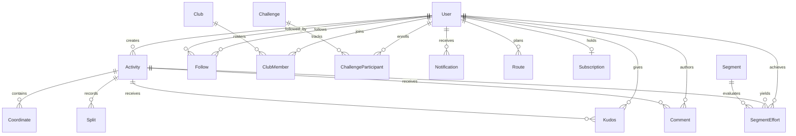

# Database Architecture & Relational Schema Design

**Target Database:** PostgreSQL 16 with PostGIS Spatial Extension  
**ORM:** Prisma ORM  
**Mobile Local Storage:** SQLite (`expo-sqlite`) in WAL Mode  

---

## 1. Storage Architecture Overview

The system strictly enforces an **Offline-First, Two-Tier Data Partitioning Model**:
1. **Tier 1 (Mobile Local Database):** Embedded SQLite database running directly on device via `expo-sqlite`. Responsible for zero-latency 1Hz GPS coordinate buffering, offline activity queueing, and immediate crash durability.
2. **Tier 2 (Cloud Relational Backend):** Containerized PostgreSQL with PostGIS extension managed via Prisma ORM on the backend. Responsible for athlete social relationships, spatial indexing, leaderboards, and cross-device sync.

```
+-------------------------------------------------------------+
|                     Mobile Client (Expo)                    |
|  [GpsEngine] -> [expo-sqlite WAL] -> [SyncManager Queue]    |
+-------------------------------------------------------------+
                               |
                               | (Authenticated HTTPS / JWT)
                               v
+-------------------------------------------------------------+
|                   Backend Express API Server                |
|  [Prisma ORM Client] -> [PostgreSQL 16 + PostGIS Spatial]   |
+-------------------------------------------------------------+
```

---

## 2. Cloud Database Schema (Prisma PostgreSQL)

### 2.1 Complete Relational Entity Diagram



### 2.2 Entity Definitions

#### `users`
- `id` (UUIDv4 Primary Key)
- `email` (VARCHAR, Unique, Indexed)
- `passwordHash` (BCrypt Hash)
- `firstName` (VARCHAR)
- `lastName` (VARCHAR)
- `avatarUrl` (VARCHAR, Nullable)
- `city` (VARCHAR, Nullable)
- `bio` (TEXT, Nullable)
- `createdAt`, `updatedAt` (TIMESTAMP)

#### `activities`
- `id` (UUIDv4 Primary Key - client-generated GUID for upload idempotency)
- `userId` (Foreign Key -> users.id, Cascade Delete)
- `name` (VARCHAR)
- `sportType` (VARCHAR - 'Run', 'Ride', 'Walk', 'Hike')
- `visibility` (VARCHAR - 'everyone', 'followers', 'only_you')
- `startTime` (TIMESTAMP)
- `elapsedTimeSeconds` (INT)
- `movingTimeSeconds` (INT)
- `distanceMeters` (FLOAT)
- `elevationGainMeters` (FLOAT)
- `calories` (INT)
- `polylineEncoded` (TEXT)
- `startLatitude`, `startLongitude` (FLOAT)
- `endLatitude`, `endLongitude` (FLOAT)
- `deviceInfo` (VARCHAR, Nullable)
- `createdAt`, `updatedAt` (TIMESTAMP)

#### `coordinates`
- `id` (BIGINT Autoincrement Primary Key)
- `activityId` (Foreign Key -> activities.id, Cascade Delete)
- `seq` (INT, Sequence Index 0, 1, 2...)
- `latitude`, `longitude` (FLOAT, WGS84)
- `altitude` (FLOAT, Nullable)
- `accuracy` (FLOAT, Horizontal Accuracy Radius)
- `speed` (FLOAT, Speed in m/s)
- `timestamp` (TIMESTAMP)

#### `splits`
- `id` (INT Autoincrement Primary Key)
- `activityId` (Foreign Key -> activities.id, Cascade Delete)
- `splitNumber` (INT)
- `distanceUnit` (VARCHAR - 'km' or 'mi')
- `movingTimeSeconds` (INT)
- `elevationDeltaMeters` (FLOAT)

#### `kudos` & `comments`
- `kudos`: Unique pair `[activityId, userId]` preventing duplicate likes.
- `comments`: Ordered by `createdAt ASC` with indexed `activityId`.

#### `notifications`
- `id` (UUIDv4 Primary Key)
- `userId` (Foreign Key -> users.id - recipient)
- `actorId` (Foreign Key -> users.id - originator)
- `type` (VARCHAR - 'kudos', 'comment', 'follow', 'challenge', 'club')
- `title` (VARCHAR)
- `message` (TEXT)
- `entityId` (VARCHAR, Nullable - activityId or clubId)
- `isRead` (BOOLEAN, Default false)
- `createdAt` (TIMESTAMP)

#### `clubs` & `club_members`
- `clubs`: `id`, `name`, `sportType`, `location`, `description`, `avatarUrl`, `isPrivate`, `creatorId`
- `club_members`: `id`, `clubId`, `userId`, `role` ('member' | 'admin'), `joinedAt`

#### `challenges` & `challenge_participants`
- `challenges`: `id`, `title`, `sportType`, `targetDistanceMeters`, `startDate`, `endDate`, `badgeIcon`
- `challenge_participants`: `id`, `challengeId`, `userId`, `progressDistanceMeters`, `completed`, `joinedAt`

#### `routes`
- `routes`: `id`, `userId`, `name`, `sportType`, `distanceMeters`, `elevationGainMeters`, `polylineEncoded`, `surfaceType`, `estimatedMovingTimeSeconds`

#### `subscriptions`
- `subscriptions`: `id`, `userId` (Unique), `tier` ('free' | 'summit'), `status` ('active' | 'expired'), `expiresAt`

---

## 3. Mobile SQLite Database (`expo-sqlite`)

The mobile client maintains 6 distinct DAOs inside embedded SQLite:
1. `activities`: Unfinished, pending, and synced workout records.
2. `activity_coordinates`: Sequential 1Hz GPS samples.
3. `activity_splits`: Real-time 1km / 1mi benchmark records.
4. `gear`: Shoes and bicycle equipment odometer records.
5. `privacy_zones`: Geofencing circles with radius and coordinates.
6. `best_efforts`: 400m, 1k, 1mi, 5k, 10k personal record splits.
