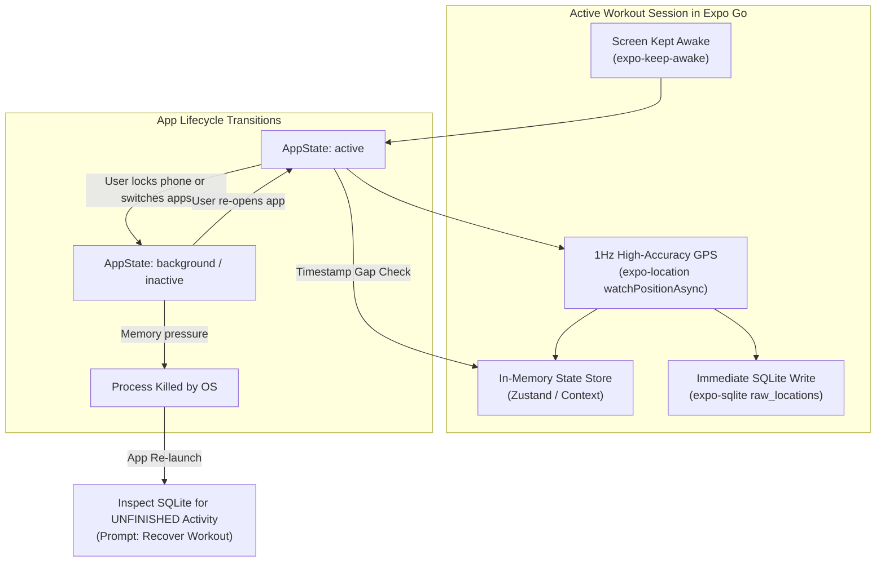

# React Native & Expo Go Feasibility Assessment

## 1. Executive Summary & Runtime Constraints

The objective is to architect an independent Strava-like fitness tracking application that executes **exclusively within the standard Expo Go client on Android devices**, with:
- Zero custom native Kotlin or C++ modules
- Zero native linking or modified Gradle files
- Zero dependency on `expo-dev-client` (development builds) during initial implementation
- 100% adherence to libraries pre-bundled inside the official Expo Go Android shell

This assessment establishes what can be built cleanly within Expo Go, defines the technical constraints (particularly surrounding background location tracking on Android), and provides an exact compatibility matrix.

---

## 2. Comprehensive Expo Go Feature Compatibility Matrix

| Strava Feature | Expo Go Feasibility | Expo-Compatible Package / Solution | Architectural Rationale & Constraints |
|---|---|---|---|
| **User Authentication** | **Full Support** | `expo-auth-session`, `expo-crypto`, `expo-secure-store` | Standard OAuth2 / WebBrowser flows; JWT tokens persisted encrypted in Android Keystore via `expo-secure-store`. |
| **Foreground GPS Tracking** | **Full Support** | `expo-location`, `expo-keep-awake` | High-frequency location updates ($1\text{Hz}$) with `Location.Accuracy.BestForNavigation`. `expo-keep-awake` prevents screen timeout. |
| **Background GPS Tracking** | **Strictly Limited (Documented Constraint)** | `expo-location` (`startLocationUpdatesAsync`), `expo-task-manager` | **Cannot guarantee continuous background tracking in Expo Go.** Detailed in Section 3 below. |
| **Local Activity Persistence** | **Full Support** | `expo-sqlite` (or `expo-sqlite/next`) | High-performance embedded SQLite database pre-bundled into Expo Go. Zero native build step required. |
| **Interactive Map Views** | **Full Support** | `react-native-maps` (`PROVIDER_GOOGLE`) | Google Maps SDK is pre-bundled in Expo Go on Android. Vector tiles and polyline overlays work seamlessly. |
| **3D Topographic Terrain Maps** | **Unsupported in Expo Go** | 2D Satellite / Hybrid views via `react-native-maps` | Strava uses custom C++ FATMAP shaders (`libFatmapSdk.so`) and Mapbox SDK (`rnmapbox`), both requiring native compilation absent in Expo Go. |
| **Route Polyline Rendering** | **Full Support** | `<Polyline>` from `react-native-maps` | Supports colored route lines, start/end custom map markers, and multi-segment color gradients. |
| **Elevation & Pace Charts** | **Full Support** | `react-native-wagmi-charts` or `react-native-svg` | Pure JavaScript / SVG chart rendering. Responsive touch scrub markers for elevation profiles. |
| **Social Activity Feed** | **Full Support** | React Native core components, `expo-image` | High-performance cached image rendering, infinite scrolling via `FlatList`, optimistic kudos toggling. |
| **Photo Uploads & Attachments** | **Full Support** | `expo-image-picker` | System gallery and camera access; automatic client-side compression before multipart upload. |
| **Haptic Feedback** | **Full Support** | `expo-haptics` | Pre-bundled native haptics for start/stop workout triggers, kudos double-tap, and milestone alerts. |
| **Audio Cues / Voice Feedback** | **Full Support** | `expo-speech` | Text-to-Speech synthesis for split alerts ("Kilometer 5: 4 minutes 52 seconds"). |
| **Local Notifications** | **Full Support** | `expo-notifications` | Periodic milestone notifications and workout recovery alerts. |
| **BLE Heart Rate & Power Sensors** | **Unsupported in Expo Go** | Postponed to Custom Dev Client (Milestone 8) | Bluetooth Low Energy (`react-native-ble-plx`) requires custom native permissions and is not supported in Expo Go. |

---

## 3. Deep Dive: Background GPS Tracking Constraints in Expo Go

### 3.1 The Technical Root Cause

Strava achieves continuous, 10-hour background recording on Android through a dedicated **Foreground Service**:
```xml
<!-- From Strava AndroidManifest.xml -->
<service 
    name="com.strava.recording.StravaActivityService" 
    enabled="true" 
    foregroundServiceType="0x8"> <!-- 0x8 = FOREGROUND_SERVICE_TYPE_LOCATION -->
</service>
```
On Android 10+ (and strictly enforced on Android 14+ / targetSdk 34+), the Android operating system terminates or throttles any background location collection unless:
1. The app runs as a Foreground Service with `foregroundServiceType="location"`.
2. A persistent, non-dismissible notification is pinned to the user's status bar.
3. The app holds an active `PARTIAL_WAKE_LOCK`.

### 3.2 The Expo Go Sandboxing Limitation

In **Expo Go**, your JavaScript bundle runs inside the host **Expo Go client application**:
- You cannot edit `AndroidManifest.xml` to declare specialized foreground service types.
- While `Location.startLocationUpdatesAsync()` with `expo-task-manager` is exposed in Expo Go, Android's OS-level **Doze Mode** and **App Standby Buckets** throttle background location polling to once every 5 to 15 minutes as soon as the screen is turned off or the user switches apps.
- If Android experiences memory pressure while Expo Go is in the background, Android's Low Memory Killer (LMK) will terminate Expo Go because it lacks an app-specific pinned Foreground Location Service.

---

## 4. Architectural Solution for Expo Go: Foreground-First Engine

To build a reliable fitness tracker within Expo Go without violating the constraint against native code, we implement a **Foreground-First Architecture**:



### 4.1 Engineering Safeguards for Expo Go:

1. **Active Screen Wake Lock (`expo-keep-awake`):**
   - When the user taps Start, the recording screen activates `activateKeepAwakeAsync()`.
   - The screen remains on with dimmed HUD while mounted on a bicycle handlebar or running armband, guaranteeing uninterrupted $1\text{Hz}$ GPS collection.
2. **Immediate Per-Point SQLite Commit:**
   - Every single GPS coordinate is inserted into the local `raw_locations` table in `expo-sqlite` the instant it is received.
   - If the user backgrounds the app and Android kills the process 20 minutes later, **zero recorded coordinates are lost**.
3. **Lifecycle Anomaly Detection (`AppState`):**
   - The recording coordinator listens to `AppState.addEventListener('change')`.
   - When transitioning from `background` back to `active`:
     - Compare `Date.now()` with the last committed coordinate timestamp.
     - If the gap $\Delta t > 15\text{ seconds}$, calculate distance jump $\Delta d$.
     - If $\Delta d > 50\text{m}$, add a `GAP_DISCONTINUITY` marker to the polyline instead of drawing an erroneous straight-line interpolation that corrupts pace calculations.
4. **Crash / Interrupt Recovery on App Launch:**
   - When the app starts, the root navigation checks `expo-sqlite`:
     `SELECT * FROM activities WHERE sync_status = 'UNFINISHED' LIMIT 1;`
   - If an unfinished session exists, a modal alert immediately appears:
     *"Recover Workout: You have an interrupted 4.2 km run from 12 minutes ago. Would you like to Resume or Save?"*
5. **Transparent Athlete Communication:**
   - The UI includes a clear banner in the Record tab:
     *"For continuous tracking in Expo Go, keep this screen visible. Background recording will be enhanced in production builds."*

---

## 5. Mapbox vs. React Native Maps Decision

| Evaluation Criteria | Mapbox Maps SDK (`@rnmapbox/maps`) | React Native Maps (`react-native-maps`) |
|---|---|---|
| **Expo Go Compatibility** | ❌ **Incompatible** (Requires custom native code) |  **Fully Compatible** (Pre-bundled in Expo Go) |
| **Android Map Engine** | Mapbox GL / Metal C++ engine | Google Maps SDK for Android |
| **Vector Polylines** | High performance with gradient styling | Standard `<Polyline>` overlay with color & width |
| **Custom Map Styles** | Mapbox Style JSON | Google Maps JSON styling |
| **Decision for Project** | Postponed to production build | **Adopted as primary map engine for Expo Go** |
