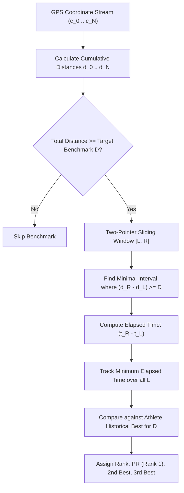

# Strava Advanced Features: Comprehensive Implementation Plan

This implementation plan details the architecture, mathematical algorithms, database schemas, component hierarchies, and rollout phases required to bring the features shown in the production Strava screenshots into the application.

---

## 1. Feature Mapping from Production Screenshots

| Screenshot | Feature Group | Visual & Functional Elements | Target Components / Files |
| :--- | :--- | :--- | :--- |
| **Screenshot 1** | **Results & Best Efforts** | • Summary counts: `Best Efforts: 7 \| Achievements: 7`<br>• Gold PR Badges with distance, time, pace, `"New best of all-time!"`<br>• Benchmark distance rows: 10K, 5K, 2 mile, 1 mile, 1K, 400m<br>• Partner/Goal card: `"PR today, ready for your next? Train with Runna >"`<br>• Link: `"View All Results"` | `components/activity/BestEffortsList.tsx`<br>`components/activity/PrBadge.tsx`<br>`features/analytics/BestEffortsEngine.ts` |
| **Screenshot 1** | **Visual Pace Splits** | • Split table: `Km \| Pace \| Visual Bar \| Elev`<br>• Proportional horizontal pace bars (blue bar scaled to pace)<br>• Elevation delta per split (`+1`, `-1`, `-0`) | `components/activity/SplitRow.tsx`<br>`components/activity/VisualSplitBar.tsx` |
| **Screenshot 2** | **Athlete Intelligence** | • Orange flame badge: `"Athlete Intelligence"`<br>• Contextual natural language workout critique (comparing last 2 weeks)<br>• Aerobic vs. Anaerobic intensity zone summary<br>• Expandable card with chevron `>` | `components/activity/AthleteIntelligenceCard.tsx`<br>`features/analytics/AthleteIntelligence.ts` |
| **Screenshot 2** | **2x2 Insights Grid** | • **Workout Analysis**: Lap pace table with active lap accent bar<br>• **Flyover**: Satellite 3D map tile with route playback trigger<br>• **Best Efforts**: 5K PR & 2nd-fastest 5K cards with dates<br>• **Performance Predictions**: 5K / 10K predicted times with delta pills (`▼ 1:40`) | `components/activity/InsightsGrid.tsx`<br>`components/activity/PerformancePredictionsCard.tsx`<br>`features/analytics/RacePredictor.ts` |
| **Screenshot 3** | **Interactive Map with PR Markers** | • Route polyline on satellite/hybrid map<br>• **Milestone Map Pins**: Gold PR trophy pins placed directly at the coordinate where the milestone was hit (`Fastest 1K Lifetime`, `Fastest 1/2 mile Lifetime`, `Fastest 1 mile Lifetime`)<br>• Floating circular Play button `▶` for 3D Flyover / Replay | `components/activity/MapMilestoneMarker.tsx`<br>`components/activity/FlyoverModal.tsx`<br>`app/activity/[id].tsx` |
| **Screenshot 3** | **Activity Hero & 6-Metric Grid** | • Header: Back chevron `v`, Activity Title, Bookmark, Overflow `...`<br>• Athlete metadata: Avatar, Name, Date/Time, City location<br>• Hero PR Banner: `"Your fastest 10K ever!"` in gold trophy card<br>• 6-Metric Grid: Distance, Avg Pace, Moving Time, Elev Gain, Calories, Max Elev<br>• Social tagging row: `"With someone who didn't record? Add Others"` | `components/activity/HeroPrBanner.tsx`<br>`components/activity/MetricGrid.tsx`<br>`app/activity/[id].tsx` |
| **Screenshot 4** | **Social Feed Card Enhancements** | • Post summary metrics: `Distance \| Pace \| Time \| Achievements 7 🏆`<br>• Gold PR Callout Card inside feed: `"Your fastest 10K ever!"`<br>• Embedded route map preview with lap loops<br>• Action bar (Kudos, Comments, Share) | `components/activity/ActivityCard.tsx`<br>`app/(tabs)/index.tsx` |
| **Screenshot 4** | **Top Navigation & Floating Tab Bar** | • Top bar: Plus `+`, Search `🔍`, Orange Upgrade pill, Messages `💬`, Notifications `🔔` with badge count `3`<br>• Floating bottom navigation bar with rounded pill shape | `components/ui/ScreenHeader.tsx`<br>`app/(tabs)/_layout.tsx` |

---

## 2. Mathematical Engines & Core Algorithms

### 2.1 Sliding-Window Best Efforts Detection Algorithm
Standard Strava benchmark distances (in meters):
$$\mathcal{D} = \{ 400\text{m}, 804.67\text{m (1/2 mi)}, 1000\text{m (1k)}, 1609.34\text{m (1 mi)}, 3218.69\text{m (2 mi)}, 5000\text{m (5k)}, 10000\text{m (10k)}, 21097.5\text{m (Half Marathon)} \}$$

Given an activity with $N$ GPS coordinates $C = [c_0, c_1, \dots, c_{N-1}]$, where each coordinate has timestamp $t_i$ and cumulative distance from start $d_i$:



#### Linear Two-Pointer Windowing:
1. For each target benchmark distance $D \in \mathcal{D}$:
   - If total activity distance $d_{N-1} < D$, continue.
   - Initialize $L = 0, R = 0$, and `bestTime = Infinity`.
   - Advance $R$ until $(d_R - d_L) \ge D$.
   - Calculate elapsed time $\Delta t = (t_R - t_L)$. If $\Delta t < \text{bestTime}$, record $\text{bestTime} = \Delta t$, $\text{startIdx} = L$, $\text{endIdx} = R$.
   - Advance $L$ by 1 sample and repeat until $R = N - 1$.
   - Query athlete's historical PR table for distance $D$. If $\text{bestTime} < \text{historicalPR}$, flag as `is_pr = true` and `rank = 1`.

### 2.2 Relative Pace Visual Bar Scaling
In Screenshot 1, split pace bars visually communicate pacing consistency across kilometers:
$$\text{barWidthPct}_k = 40\% + 60\% \times \left( \frac{\text{maxPaceSec} - \text{splitPaceSec}_k}{\max(1, \text{maxPaceSec} - \text{minPaceSec})} \right)$$
- The fastest split (minimum seconds/km) renders at **100% width**.
- The slowest split (maximum seconds/km) renders at **40% width** (ensuring baseline visibility).
- Normalized linearly between $40\%$ and $100\%$.

### 2.3 Race Performance Predictor (Pete Riegel Power Model)
To calculate projected 5K and 10K finish times (Screenshot 2):
$$T_2 = T_1 \times \left( \frac{D_2}{D_1} \right)^{1.06}$$
Where:
- $D_1$ is the distance of the athlete's best recent effort, and $T_1$ is the moving time.
- $D_2$ is the target prediction distance (e.g. 5,000m or 10,000m).
- The fatigue exponent $1.06$ is the sports science standard for endurance runners.
- The delta pill compares $T_2$ with the previous calendar month's prediction:
$$\Delta T = T_{2,\text{previous}} - T_{2,\text{current}} \implies \text{e.g. } \boldsymbol{\nabla} \text{ 1:40 (faster)}$$

### 2.4 Athlete Intelligence Engine
The intelligence engine analyzes activity telemetry and produces human-like coaching feedback:
1. **Pace Benchmark Comparison**: Evaluates current average pace against the athlete's moving average over the past 14 days.
2. **Heart Rate & Intensity Zones**:
   - Zone 1 (Recovery): $<60\%$ max HR
   - Zone 2 (Aerobic): $60\% - 70\%$ max HR
   - Zone 3 (Tempo): $70\% - 80\%$ max HR
   - Zone 4 (Threshold): $80\% - 90\%$ max HR
   - Zone 5 (Anaerobic): $>90\%$ max HR
3. **Pacing Strategy Classifier**:
   - **Negative Split**: Second half $>3\%$ faster than first half.
   - **Even Split**: Variance $\le 2\%$.
   - **Positive Split / Early Burnout**: Second half $>5\%$ slower than first half.

---

## 3. Database Architecture & Schema Extensions

### 3.1 Mobile SQLite (`DatabaseClient.ts` / `expo-sqlite`)

```sql
-- 1. Athlete Lifetime Personal Records
CREATE TABLE IF NOT EXISTS athlete_prs (
    id TEXT PRIMARY KEY,
    athlete_id TEXT NOT NULL,
    benchmark_name TEXT NOT NULL,        -- '400m', '1/2 mi', '1k', '1 mi', '2 mi', '5k', '10k'
    distance_meters REAL NOT NULL,
    best_time_seconds INTEGER NOT NULL,
    activity_id TEXT NOT NULL,
    achieved_timestamp INTEGER NOT NULL,
    updated_at INTEGER NOT NULL
);

-- 2. Activity Best Efforts (Per-Workout Milestones)
CREATE TABLE IF NOT EXISTS activity_best_efforts (
    id TEXT PRIMARY KEY,
    activity_id TEXT NOT NULL,
    benchmark_name TEXT NOT NULL,
    distance_meters REAL NOT NULL,
    elapsed_time_seconds INTEGER NOT NULL,
    pace_seconds_per_km REAL NOT NULL,
    start_index INTEGER NOT NULL,
    end_index INTEGER NOT NULL,
    start_latitude REAL NOT NULL,
    start_longitude REAL NOT NULL,
    end_latitude REAL NOT NULL,
    end_longitude REAL NOT NULL,
    rank INTEGER NOT NULL DEFAULT 1,      -- 1 = PR, 2 = 2nd best, 3 = 3rd best
    is_pr INTEGER NOT NULL DEFAULT 0,     -- 1 if historical all-time PR
    created_at INTEGER NOT NULL,
    FOREIGN KEY (activity_id) REFERENCES activities(id) ON DELETE CASCADE
);

-- 3. Performance Predictions
CREATE TABLE IF NOT EXISTS performance_predictions (
    id TEXT PRIMARY KEY,
    athlete_id TEXT NOT NULL,
    distance_key TEXT NOT NULL,           -- '5K', '10K', 'Half', 'Marathon'
    predicted_time_seconds INTEGER NOT NULL,
    predicted_pace_seconds_km REAL NOT NULL,
    delta_seconds INTEGER DEFAULT 0,      -- Improvement in seconds (e.g. -100 for 1:40 faster)
    updated_at INTEGER NOT NULL
);

-- 4. Activity Athlete Intelligence Summaries
CREATE TABLE IF NOT EXISTS activity_insights (
    activity_id TEXT PRIMARY KEY,
    summary_headline TEXT NOT NULL,
    full_critique TEXT NOT NULL,
    anaerobic_pct INTEGER DEFAULT 0,
    aerobic_pct INTEGER DEFAULT 0,
    cadence_rating TEXT,                  -- 'Optimal', 'Low', 'High'
    split_strategy TEXT,                  -- 'Negative Split', 'Even', 'Positive Split'
    created_at INTEGER NOT NULL
);
```

---

## 4. UI Component Architecture & Design Tokens

Strictly following the **Quiet Excellence** design system (`constants/theme.ts`):
- `borderWidth: 1`, `borderColor: colors.border`
- `borderRadius: radii.sm` (8px) / `radii.md` (12px)
- `shadows.none` (`elevation: 0`, `shadowOpacity: 0`)
- Curated color tokens:
  - Gold Trophy / PR Accent: `#F59E0B` (Amber-500)
  - Silver Medal Accent: `#94A3B8` (Slate-400)
  - Bronze Medal Accent: `#D97706` (Amber-600)
  - Split Visual Bar: `colors.routeColor` (`#3B82F6` blue)
  - Green Delta Pill: `#10B981` (Emerald-500)

```
components/
├── activity/
│   ├── ActivityCard.tsx              [Updated: PR Hero callout & Achievements count]
│   ├── BestEffortsList.tsx           [Screenshot 1: 10K, 5K, 2mi PR rows with gold medals]
│   ├── PrBadge.tsx                   [Gold ribbon PR trophy icon component]
│   ├── VisualSplitBar.tsx            [Screenshot 1: Split row with horizontal bar & elev]
│   ├── AthleteIntelligenceCard.tsx   [Screenshot 2: Flame badge & AI summary critique]
│   ├── InsightsGrid.tsx              [Screenshot 2: 2x2 grid (Workout, Flyover, PRs, Predictions)]
│   ├── PerformancePredictionsCard.tsx[Screenshot 2: 5K/10K prediction card with delta pills]
│   ├── MapMilestoneMarker.tsx        [Screenshot 3: PR trophy flags pinned on map track]
│   ├── FlyoverModal.tsx              [Screenshot 2 & 3: 3D animated route replay modal]
│   └── HeroPrBanner.tsx              [Screenshot 3 & 4: "Your fastest 10K ever!" card]
```

---

## 5. Screen Layout & Detail Overhaul (`app/activity/[id].tsx`)

```mermaid
graph TD
    Screen["Activity Detail Screen [id].tsx"]
    
    subgraph Top Half (40% Screen Height)
        Map["Interactive MapView with Polyline"]
        StartFinish["Start & Finish Markers"]
        PrPins["MapMilestoneMarker (Fastest 1K, 1/2mi, 1mi)"]
        PlayBtn["Floating Flyover Play Button ▶"]
        TopNav["Back 'v', Run Title, Bookmark, Menu '...'"]
    end
    
    subgraph Bottom Sheet (Scrollable)
        AthleteRow["Athlete Avatar + Name + Date/Time + Location"]
        Title["Large Title: Sunday morning 25 oct"]
        HeroPR["HeroPrBanner: 'Your fastest 10K ever!'"]
        SixGrid["6-Metric Grid (Dist, Pace, Time, Elev, Cals, MaxElev)"]
        SocialTag["With someone who didn't record? [Add Others]"]
        
        SectionAI["'Get smarter insights for faster progress.'"]
        AICard["AthleteIntelligenceCard (AI run critique)"]
        TwoByTwo["InsightsGrid (Workout Laps, Flyover, Best Efforts, Predictions)"]
        
        SectionResults["'Results' Header: Best Efforts: 7 | Achievements: 7"]
        BestEfforts["BestEffortsList (10K, 5K, 2mi PR rows)"]
        PromoCard["Runna Next Goal Training Card"]
        
        SectionSplits["'Splits' Table"]
        SplitsTable["VisualSplitBar Rows (Pace bars + Elevation deltas)"]
    end
    
    TopNav --> Screen
    Map --> Screen
    PrPins --> Map
    PlayBtn --> Map
    
    AthleteRow --> Bottom Sheet
    HeroPR --> Bottom Sheet
    SixGrid --> Bottom Sheet
    AICard --> Bottom Sheet
    TwoByTwo --> Bottom Sheet
    BestEfforts --> Bottom Sheet
    SplitsTable --> Bottom Sheet
```

---

## 6. Implementation Rollout Phases

### Phase 1: Core Calculation Engines & Database Schema
- [ ] Create `BestEffortsEngine.ts`: Sliding-window algorithm over GPS coordinates for standard benchmarks (400m, 1/2mi, 1k, 1mi, 2mi, 5k, 10k).
- [ ] Create `RacePredictor.ts`: Pete Riegel formula implementation predicting 5K/10K times with delta tracking.
- [ ] Update `DatabaseClient.ts` to add SQLite tables: `activity_best_efforts`, `athlete_prs`, `performance_predictions`, `activity_insights`.
- [ ] Seed initial historical PR records for testing.

### Phase 2: Visual Splits & Best Efforts Components
- [ ] Create `PrBadge.tsx`: Gold ribbon PR medal SVG/vector badge.
- [ ] Create `VisualSplitBar.tsx`: Horizontal proportional pace bars with net elevation deltas.
- [ ] Create `BestEffortsList.tsx`: Results list with summary counts (`Best Efforts: 7 | Achievements: 7`) and PR rows.
- [ ] Create `HeroPrBanner.tsx`: Prominent `"Your fastest 10K ever!"` banner with gold icon.

### Phase 3: Athlete Intelligence & Insights Grid
- [ ] Create `AthleteIntelligence.ts`: Heuristic rule engine for pace comparison, heart rate zones, and split stability critique.
- [ ] Create `AthleteIntelligenceCard.tsx`: Dark surface card with flame badge and AI summary text.
- [ ] Create `InsightsGrid.tsx`: 2x2 widget matrix (Workout Analysis laps, Flyover teaser, Best Efforts, Performance Predictions).
- [ ] Create `PerformancePredictionsCard.tsx`: Race predictions with green improvement delta pills (`▼ 1:40`).

### Phase 4: Interactive Map Pins & 3D Flyover Replay
- [ ] Create `MapMilestoneMarker.tsx`: Custom markers positioned at the exact GPS point where the athlete clocked their fastest milestone.
- [ ] Create `FlyoverModal.tsx`: Smooth timer/Reanimated camera playback animating along the GPS track with speed telemetry.
- [ ] Add the floating circular Play button `▶` on the activity detail map.

### Phase 5: Activity Detail Screen & Feed Card Integration
- [ ] Overhaul `app/activity/[id].tsx` with the complete layout hierarchy matching Screenshots 1, 2, and 3.
- [ ] Update `components/activity/ActivityCard.tsx` with inline `Achievements 7 🏆` badge and Hero PR callout card.
- [ ] Polish top app bar in `app/(tabs)/index.tsx` with Upgrade button and notification badge.
- [ ] Run `npx tsc --noEmit` and end-to-end verification.

---

> [!NOTE]
> All components will strictly utilize our zero-shadow, 1px border tokens from `constants/theme.ts` to maintain the **Quiet Excellence** aesthetic.
