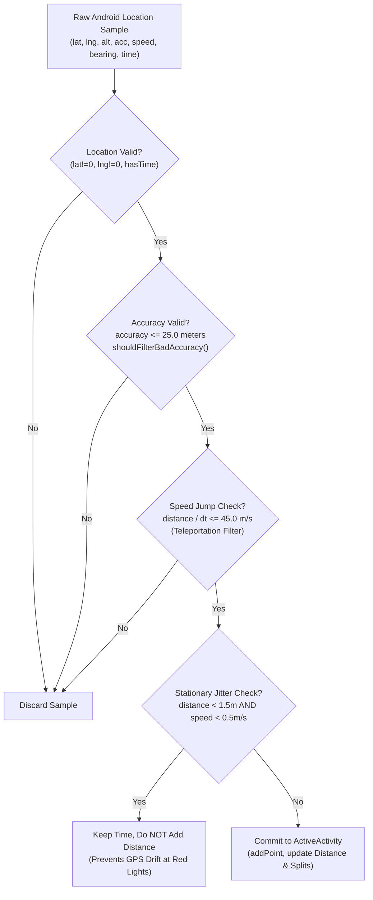
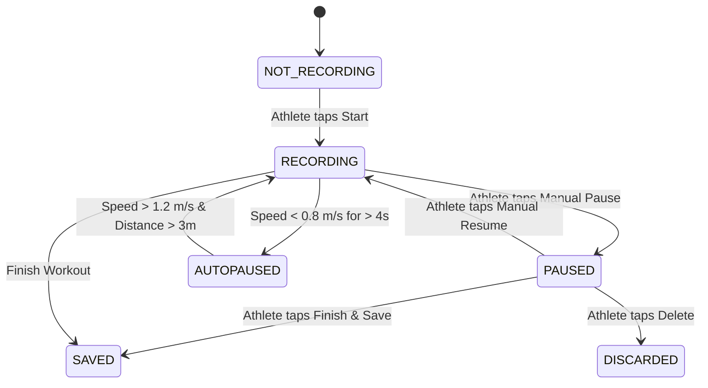

# Strava GPS Recording Engine: Deep Technical Analysis & Implementation Design

## 1. Executive Summary

The GPS recording engine is the mission-critical core of any fitness tracking application. Based on our reverse engineering of the Strava Android APK (`v486.11`), Strava's recording subsystem balances four competing physical constraints:
1. **Geometric Accuracy:** Mitigating multipath reflections, GPS jitter, and satellite drift.
2. **Temporal Integrity:** Accurately calculating moving time versus elapsed time across pauses.
3. **OS Survivability:** Surviving Android aggressive background power management (Doze mode, App Standby, Low Memory Killer).
4. **Data Durability:** Ensuring zero data loss in the event of unexpected application crash or hardware battery depletion.

This document presents a deep dive into Strava's actual APK implementation discovered during reverse engineering, followed by our architectural design for an independent GPS recording engine.

---

## 2. Reverse-Engineered Strava GPS Subsystem

### 2.1 Location Collection & Filtering Pipeline

Through inspection of `com.strava.recording.data.RecordingLocation` and `ActiveActivity`, Strava's location ingestion pipeline follows a strict mathematical validation chain before any point is committed:



#### Key Class Discoveries & Method Evidence:
- **`RecordingLocation.kt`:**
  - `accuracy: Float`, `verticalAccuracyMeters: Float`
  - `hasMslAltitude: Boolean` (Mean Sea Level barometric/geoid correction)
  - `elapsedTimeMs: Long` vs. `systemTimeMs: Long` (Strava explicitly tracks monotonic elapsed time using `SystemClock.elapsedRealtime()` alongside wall-clock time `System.currentTimeMillis()` to prevent clock adjustments or daylight savings from distorting pace).
  - `shouldFilterBadAccuracy(): Boolean` (Filters out any GPS fix exceeding the accuracy threshold, typically $>25\text{m}$).
  - `toGeoPointImpl(): TimedGeoPoint` (Converts raw Android location to an immutable mathematical waypoint).

---

### 2.2 Recording State Machine (APK Discovered)

In `com.strava.recording.data.RecordingState`, Strava defines six distinct lifecycle states:



- **`RecordingState` Enum Values:**
  - `NOT_RECORDING`: Engine idle; listening for GPS fix only to show athlete position on map.
  - `RECORDING`: Active GPS recording; distances accumulate, moving timer increments, splits calculate.
  - `PAUSED`: Manual pause initiated by athlete; timer stops, GPS continues at low frequency.
  - `AUTOPAUSED`: Triggered automatically by speed heuristics (`PauseType.AUTO_PAUSE`).
  - `SAVED`: Activity finalized; written to SQLite disk, ready for sync.
  - `DISCARDED`: Session deleted; local database entries cleaned up.

---

### 2.3 Distance, Pace & Elevation Calculations

1. **Distance Calculation:**
   - Strava calculates spherical distance between consecutive filtered points $P_1(\phi_1, \lambda_1)$ and $P_2(\phi_2, \lambda_2)$ using the **Haversine Formula**:
     $$\Delta \sigma = 2 \arcsin \sqrt{\sin^2\left(\frac{\Delta \phi}{2}\right) + \cos \phi_1 \cos \phi_2 \sin^2\left(\frac{\Delta \lambda}{2}\right)}$$
     $$d = R \cdot \Delta \sigma \quad (R = 6,371,000 \text{ meters})$$
   - Points with displacement $\Delta d < 1.5\text{m}$ when athlete speed is near zero are ignored to eliminate stationary wandering.
2. **Current Pace vs. Average Pace:**
   - **Average Pace:** $\text{Pace}_{\text{avg}} = \frac{\text{Moving Time (seconds)}}{\text{Total Distance (km)}}$.
   - **Current Pace Smoothing:** Instantaneous GPS speed ($v = \Delta d / \Delta t$) is notoriously noisy due to atmospheric Doppler fluctuations. Strava calculates current pace using a **rolling window** of location samples over the preceding 5 to 10 seconds:
     $$\bar{v} = \frac{\sum_{i=1}^{k} \Delta d_i}{\sum_{i=1}^{k} \Delta t_i}, \quad \text{Pace} = \frac{1}{\bar{v}}$$
3. **Elevation Gain Smoothing:**
   - Raw GPS vertical altitude ($z$) has 2x to 3x the margin of error of horizontal coordinates.
   - Strava uses `ElevationStatsCalculator` (`mElevationStatsCalculator` in `ActiveActivity`).
   - A hysteresis threshold is enforced: vertical elevation gain is only credited if cumulative ascent exceeds a minimum climb delta (typically $+3\text{m}$ to $+5\text{m}$), preventing micro-barometric noise from falsely reporting hundreds of feet of climb on flat ground.

---

### 2.4 Persistence, Crash Recovery & Deduplication

1. **Incremental Local Disk Persistence:**
   - Every location point is not just kept in memory; `mRecordingDiskDataSource` writes waypoints to the local SQLite `RecordingDatabase`.
   - The session entity is `UnsyncedActivity`, uniquely identified by a client-generated UUID `guid` (e.g. `c9bf9e57-1685-4c89-b845-983226a27fa9`).
2. **Crash Recovery Mechanism:**
   - `CrashRecoveryState` records the last active state, current lap, and sport type.
   - If Android OS terminates the app process, Android `JobScheduler` fires `RestartRecordingJobService`, which inspects `RecordingDatabase` for any activity with `syncState = UNFINISHED`.
   - On app restart, `ActiveActivity.processPointForRecovery()` re-hydrates the session from disk and allows the athlete to seamlessly resume recording without losing the prior miles.
3. **Battery Drain Telemetry:**
   - `UnsyncedActivity` explicitly stores `startBatteryLevel: Float` and `endBatteryLevel: Float`. This allows Strava engineers to monitor GPS battery drain rates across device manufacturers and OS versions.

---

## 3. Proposed GPS Engine Design for Our Implementation

### 3.1 Extended Production State Machine

To guarantee enterprise robustness in our independent fitness tracking platform, we propose a 9-state formal state machine:

```mermaid
stateDiagram-v2
    [*] --> IDLE
    IDLE --> PREPARING: Athlete opens Record tab
    PREPARING --> RECORDING: GPS Lock Acquired (accuracy <= 15m) & Tap Start
    PREPARING --> IDLE: Athlete exits screen

    RECORDING --> PAUSED: Athlete taps Pause
    PAUSED --> RECORDING: Athlete taps Resume

    RECORDING --> AUTOPAUSED: Speed < 0.8 m/s for 4s
    AUTOPAUSED --> RECORDING: Speed > 1.2 m/s & Distance > 3m

    RECORDING --> STOPPING: Athlete taps Stop
    PAUSED --> STOPPING: Athlete taps Stop

    STOPPING --> SAVING: Confirm Workout Summary
    STOPPING --> IDLE: Discard Activity (Cleanup SQLite)

    SAVING --> SYNCING: Activity Committed to SQLite (sync_status=PENDING)
    SYNCING --> COMPLETED: Server HTTP 201 Upload Verified (sync_status=SYNCED)
    SYNCING --> FAILED: Network Error / Timeout (Retain for Retry)
    FAILED --> SYNCING: Network Re-established or Manual Retry
```



### 3.2 State Definitions, Transitions & Invariants

| State | Entry Condition | Activity During State | Exit Condition | Invariants Enforced |
|---|---|---|---|---|
| **IDLE** | Initial application state. | GPS off; battery drain is zero. | User navigates to Record screen $\to$ `PREPARING`. | No GPS listeners registered. |
| **PREPARING** | Athlete opens Record screen. | Acquires foreground GPS lock; displays satellite accuracy indicator (Red/Yellow/Green). | User taps Start $\to$ `RECORDING`, or exits $\to$ `IDLE`. | No workout data is accumulated. |
| **RECORDING** | Start button tapped with acceptable GPS fix. | GPS updates collected at $1\text{Hz}$; distance, moving time, splits, and elevation calculate; points saved to SQLite. | User taps Pause $\to$ `PAUSED`; auto-pause triggers $\to$ `AUTOPAUSED`; Stop tapped $\to$ `STOPPING`. | WakeLock active; every point persisted to SQLite. |
| **PAUSED** | Athlete explicitly taps pause. | Moving timer paused; elapsed timer continues; points collected at reduced rate ($0.2\text{Hz}$) to preserve battery. | User taps Resume $\to$ `RECORDING`; Stop tapped $\to$ `STOPPING`. | Distance does NOT accumulate. |
| **AUTOPAUSED** | Speed $< 0.8\text{m/s}$ for $>4\text{s}$. | Identical to PAUSED, but distinct UI label ("Auto-paused"). | Speed $> 1.2\text{m/s}$ and displacement $>3\text{m}$ $\to$ `RECORDING`. | Instant resume upon physical movement. |
| **STOPPING** | Athlete taps finish. | GPS listeners detached; WakeLock released; calculates final statistics. | Athlete confirms save $\to$ `SAVING`; athlete discards $\to$ `IDLE`. | Coordinates array is immutable. |
| **SAVING** | Athlete confirms title and notes. | Atomic SQLite transaction commits workout record with status `PENDING`. | Transaction committed $\to$ `SYNCING`. | Local data durable before any network attempt. |
| **SYNCING** | Enqueued in background upload queue. | Multi-part JSON/GPX upload sent to backend with idempotency `uuid`. | HTTP 201 received $\to$ `COMPLETED`; Network failure $\to$ `FAILED`. | Retries use exponential backoff. |
| **COMPLETED** | Upload confirmed by server. | Marks SQLite `sync_status = SYNCED`; displays post-workout summary. | Athlete closes summary $\to$ `IDLE`. | Full activity available on cloud feed. |
| **FAILED** | Network unavailable or timeout. | Retains complete workout locally; displays offline indicator. | Background reconnect $\to$ `SYNCING`. | Zero data loss guaranteed. |

---

## 4. GPS Mathematics & Filtering Implementation Specifications

### 4.1 Haversine Distance (TypeScript Implementation)

```typescript
export function calculateHaversineDistance(
  lat1: number,
  lon1: number,
  lat2: number,
  lon2: number
): number {
  const EARTH_RADIUS_METERS = 6371000;
  const toRadians = (deg: number) => (deg * Math.PI) / 180;

  const dLat = toRadians(lat2 - lat1);
  const dLon = toRadians(lon2 - lon1);

  const a =
    Math.sin(dLat / 2) * Math.sin(dLat / 2) +
    Math.cos(toRadians(lat1)) *
      Math.cos(toRadians(lat2)) *
      Math.sin(dLon / 2) *
      Math.sin(dLon / 2);

  const c = 2 * Math.atan2(Math.sqrt(a), Math.sqrt(1 - a));
  return EARTH_RADIUS_METERS * c;
}
```

### 4.2 Multi-Stage GPS Filter (Noise & Teleportation Rejection)

```typescript
export interface LocationPoint {
  latitude: number;
  longitude: number;
  altitude: number | null;
  accuracy: number | null;
  speed: number | null;
  timestamp: number; // Monotonic ms
}

export class GpsPointFilter {
  private lastAcceptedPoint: LocationPoint | null = null;
  private readonly MAX_HORIZONTAL_ACCURACY_METERS = 25.0;
  private readonly MAX_PLAUSIBLE_SPEED_MPS = 45.0; // 162 km/h
  private readonly MIN_DISPLACEMENT_METERS = 1.5;

  public processPoint(point: LocationPoint): {
    accepted: boolean;
    distanceDelta: number;
    reason?: string;
  } {
    // Stage 1: Accuracy Filter
    if (point.accuracy === null || point.accuracy > this.MAX_HORIZONTAL_ACCURACY_METERS) {
      return { accepted: false, distanceDelta: 0, reason: 'LOW_ACCURACY' };
    }

    if (!this.lastAcceptedPoint) {
      this.lastAcceptedPoint = point;
      return { accepted: true, distanceDelta: 0 };
    }

    const deltaDistance = calculateHaversineDistance(
      this.lastAcceptedPoint.latitude,
      this.lastAcceptedPoint.longitude,
      point.latitude,
      point.longitude
    );

    const deltaTimeSeconds = (point.timestamp - this.lastAcceptedPoint.timestamp) / 1000;

    // Stage 2: Temporal Anomaly Filter
    if (deltaTimeSeconds <= 0) {
      return { accepted: false, distanceDelta: 0, reason: 'INVALID_TIMESTAMP' };
    }

    // Stage 3: Teleportation / Unrealistic Speed Spike Filter
    const calculatedSpeed = deltaDistance / deltaTimeSeconds;
    if (calculatedSpeed > this.MAX_PLAUSIBLE_SPEED_MPS) {
      return { accepted: false, distanceDelta: 0, reason: 'TELEPORTATION_SPIKE' };
    }

    // Stage 4: Stationary Drift / Jitter Filter
    if (deltaDistance < this.MIN_DISPLACEMENT_METERS && (point.speed ?? 0) < 0.5) {
      return { accepted: true, distanceDelta: 0, reason: 'STATIONARY_DRIFT' };
    }

    this.lastAcceptedPoint = point;
    return { accepted: true, distanceDelta: deltaDistance };
  }

  public reset(): void {
    this.lastAcceptedPoint = null;
  }
}
```

### 4.3 Rolling Window Pace Smoothing

Instantaneous pace fluctuates violently. We maintain a circular buffer of the most recent 5 location fixes to compute a steady, readable pace display:

```typescript
export class PaceSmoother {
  private buffer: { distance: number; timeSec: number }[] = [];
  private readonly WINDOW_SIZE = 5;

  public addSample(distanceMeters: number, timeDeltaSeconds: number): void {
    this.buffer.push({ distance: distanceMeters, timeSec: timeDeltaSeconds });
    if (this.buffer.length > this.WINDOW_SIZE) {
      this.buffer.shift();
    }
  }

  public getPaceSecondsPerKilometer(): number | null {
    const totalDist = this.buffer.reduce((acc, s) => acc + s.distance, 0);
    const totalTime = this.buffer.reduce((acc, s) => acc + s.timeSec, 0);

    if (totalDist < 5.0 || totalTime <= 0) return null; // Insufficient movement

    const speedMps = totalDist / totalTime;
    return 1000 / speedMps; // Seconds per km
  }
}
```
