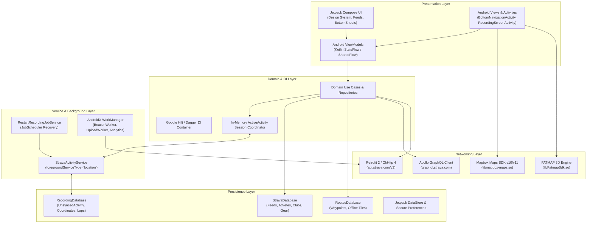
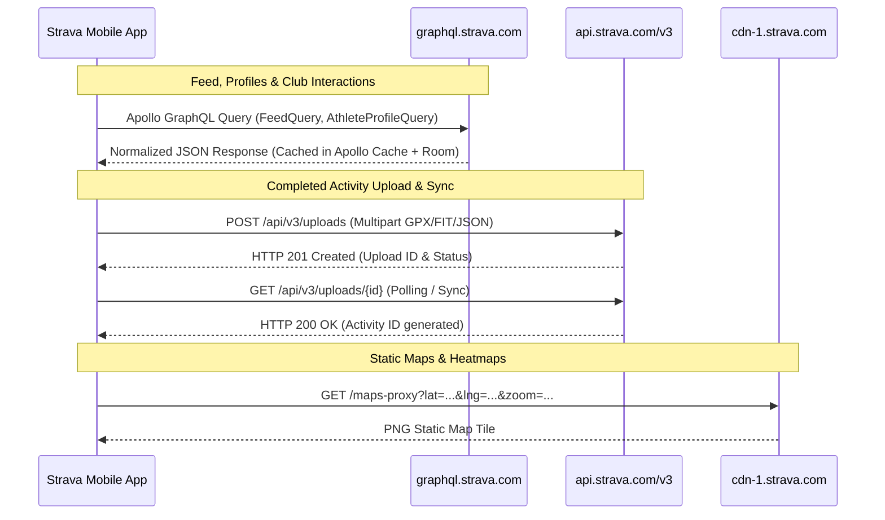
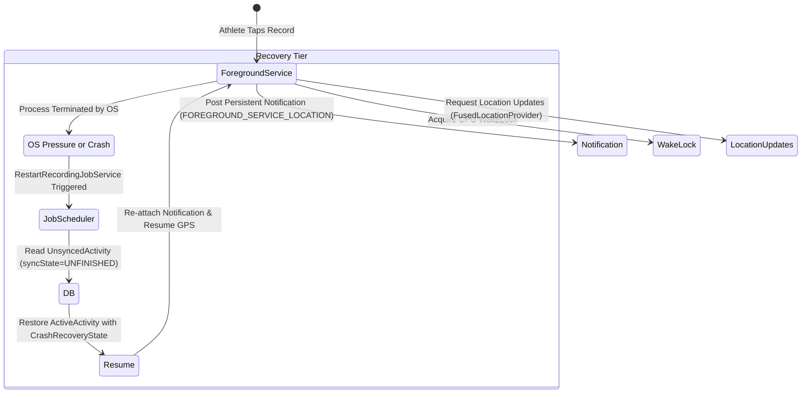
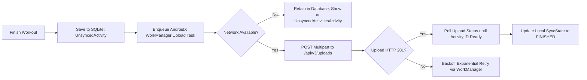

# Strava Technical System Architecture

## 1. Architectural Overview

Strava Android (`v486.11`) employs an enterprise-grade, offline-first mobile architecture built on Android Jetpack standards and layered clean-architecture principles:

---

## 2. Subsystem Architecture Breakdown

### 2.1 Presentation & UI Layer

- **Framework Strategy:** Transitioning from legacy XML layouts to **Jetpack Compose**. Over 150 Compose-related classes exist in the analyzed APK, notably in newly authored modules like `com.strava.chats`, `com.strava.bestefforts.ui.history.BestEffortsHistoryComposeActivity`, and `com.strava.flyover.ui.compose`.
- **Navigation Structure:** Single-activity shell architecture anchored by `com.strava.view.bottomnavigation.BottomNavigationActivity`, hosting 5 root tabs:
  1. `Home` (`res/menu/bottom_navigation_menu_new_nav.xml` ID `0x7f0a08f9`)
  2. `Maps` (`0x7f0a08fa`)
  3. `Record` (`0x7f0a08fc`)
  4. `Groups` (`0x7f0a08f7`)
  5. `You` (`0x7f0a0906`)
- **State Management:** Reactive unidirectional data flow (MVI / MVVM) utilizing Kotlin `StateFlow` and `SharedFlow`. ViewModels expose immutable `UiState` data classes; user intents trigger coroutine jobs in `viewModelScope`.
- **Dependency Injection:** Full Google Hilt integration (`@HiltAndroidApp` on `StravaApplication`, with generated `Hilt_*` base classes for Fragments and Activities).

---

### 2.2 Networking & API Architecture

Strava implements a hybrid API pattern balancing modern query flexibility with high-throughput binary ingestion:

#### Confirmed Endpoints from APK Bytecode:
1. **GraphQL Gateway:** `https://graphql.strava.com` & `https://graphql-clients.prod.strava.com`
   - Handles feed generation, athlete social graphs, club discussions, and best efforts history.
2. **REST Core API:** `https://www.strava.com/api/v3/`
   - Handles binary workout uploads, account settings, authentication, and billing webhooks.
3. **Heatmap & Tile Services:**
   - Global Heatmap: `https://heatmap-external-c.strava.com/tiles-auth/%s/mobileblue/{z}/{x}/{y}@2x.png?px=512&v=21`
   - Personal Heatmap: `https://personal-heatmaps-external.strava.com/tiles/athlete_id/color/{z}/{x}/{y}@2x.png`
   - Planet Vector Styles: `https://tiles.strava.com/map-styles/planet/releases/`
4. **Map Image Proxy:**
   - `https://cdn-1.strava.com/maps-proxy?lat={lat}&lng={lng}&zoom={z}&width={width}&height={height}&retina={retina}`

---

### 2.3 Authentication, Session & Security

- **Session Tokens:** OAuth 2.0 Bearer tokens containing an Access Token (short-lived) and a Refresh Token (long-lived). Tokens are refreshed automatically via an OkHttp `Authenticator` interceptor.
- **Hardware Attestation:** Evidenced by `com.strava.attestation.api.models.AttestationErrorResponse` and `AttestationTypeValue`. Strava validates hardware device integrity via Google Play Integrity API to prevent mock GPS spoofing and leaderboards fraud.
- **Screen Privacy:** Declares `android.permission.DETECT_SCREEN_CAPTURE` to detect screenshot events during social messaging and privacy-sensitive flows.

---

### 2.4 Local Storage & Database Architecture

Strava implements a multi-database Room architecture to isolate storage domains and minimize SQLite lock contention:

| Database Class | Managed DAOs | Storage Purpose |
|---|---|---|
| `RecordingDatabase` | In-memory / local tables | Unsynced activities, GPS point streams, lap records, and crash checkpoint states. |
| `StravaDatabase` | `ActivityDao`, `ClubDao`, `GearDao` | Cache for social feeds, followed athletes, club rosters, and gear mileage. |
| `RoutesDatabase` | `RoutesDao`, `SavedRouteIdDao` | User saved routes, route waypoints, elevation profiles, and direction cues. |
| `OfflineMapDatabase` | `OfflineMapDao` | Vector map tile blobs (`Tiles` table) and map parameters (`MapParams` table). |
| `ChallengeDatabase` | `ChallengeDao` | Active challenges, gallery filters, and completed challenge trophy cards. |
| `PrivacyZonesDatabase` | `PrivacyZonesDao` | Lat/Long coordinates and radii defining athlete exclusion zones. |
| `AnalyticsCacheDatabase` | `AnalyticsDao` | Offline event buffer holding telemetry events before periodic batch flush. |

---

### 2.5 Background Services & Process Recovery Architecture

To ensure uninterrupted GPS recording even when the athlete switches apps or locks the phone, Strava utilizes a 3-tier background resilience model:

1. **Foreground Location Service (`StravaActivityService`):**
   - Declared with `foregroundServiceType="0x8"` (`location`), which satisfies Android 10+ and 14+ background execution restrictions.
   - Shows a high-priority ongoing notification (`InProgressRecordingUpdater`) displaying elapsed time, distance, and current pace.
   - Holds an `android.os.PowerManager.WakeLock` to prevent the device CPU from deep-sleeping during active recording.
2. **Crash Recovery Daemon (`RestartRecordingJobService`):**
   - Registered with `android.permission.BIND_JOB_SERVICE`.
   - Schedules a persistent job via Android `JobScheduler`. If the process is terminated by Android's Low Memory Killer (LMK) or unexpected exception, the job scheduler restarts the service and recovers the active session from disk.
3. **Boot Receiver (`RecoverActivityReceiver`):**
   - Listens to `android.intent.action.BOOT_COMPLETED`. If the device shut down or ran out of battery during a workout, on restart Strava marks the activity as pending recovery or saves it safely.

---

### 2.6 Mapping Architecture & Graphics Pipelines

Strava combines two distinct rendering pipelines:
1. **Mapbox Maps SDK v10/v11 (`libmapbox-maps.so` & `libmapbox-common.so`):**
   - Powers the 2D vector map views in `RecordingScreenActivity` and `ActivityDetailActivity`.
   - Renders vector tiles styled via `assets/Shared/Configs/StravaPlanetTopoDark/style.json`.
   - Uses Mapbox dynamic line layers to draw polylines with color gradients mapping to pace, heart rate, or elevation.
2. **FATMAP 3D Terrain Engine (`libFatmapSdk.so`):**
   - Custom C++ OpenGL/Vulkan rendering engine (21.1 MB native library).
   - Utilizes custom shaders extracted in `assets/RTShaderLib/GLSL/` and `assets/Main/` (e.g. `ShadowVolumeExtude.program`, `SGXLib_CookTorrance.glsl`, `FFPLib_Texturing.glsl`).
   - Renders realistic 3D topography and winter/summer terrain contour maps for trail running and backcountry skiing.

---

### 2.7 Data Synchronization & Upload Lifecycle

1. **Immediate Local Commit:** The completed activity is saved to `RecordingDatabase` with `syncState = UNFINISHED` and a unique client-generated `guid` (UUIDv4).
2. **Idempotent Network Enqueue:** `WorkManager` manages upload tasks with exponential backoff retry constraints. Because the `guid` is transmitted with the upload payload, duplicate submissions are rejected server-side if an upload succeeds during a network drop.
3. **Unsynced Activity Manager:** If network remains unavailable, athletes can view, retry, or manually export unfinished workouts through `UnsyncedActivitiesActivity`.
