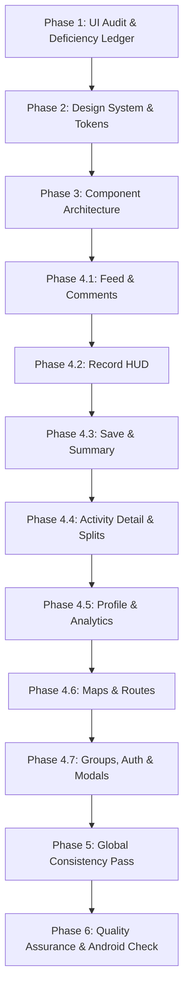

# UI Implementation Plan: Premium Professional Fitness Experience

**Product Vision:** Transform the Strava React Native application into a world-class, commercial-grade fitness platform characterized by **quiet excellence** — athletic minimalism, disciplined typographic hierarchy, mathematical spacing, and robust data visualization without visual gimmicks.

---

## 1. Executive Summary & Design Vision

### 1.1 The "Quiet Excellence" Aesthetic
Modern athletic products (e.g., Strava, Wahoo, COROS, Garmin Connect) do not rely on flashy trends, neon glows, glassmorphism, or decorative clutter. Their beauty stems from:
- **Precision Typography:** Monospaced and tabular numerals for split seconds, distance, and heart rate; high-contrast editorial hierarchy for headings and metadata.
- **Architectural Spacing:** Strict adherence to an 8-point baseline grid that prevents claustrophobia while maintaining high information density.
- **Controlled Palette:** Monochromatic foundation with a single, iconic athletic orange (`#FC5200`) used intentionally for primary actions, GPS tracking states, and key achievement accents.
- **Restrained Surfaces:** Subtle 1px structural borders instead of heavy drop shadows or floating colored cards.

### 1.2 Non-Negotiable Directives
| Strict Avoidance | Mandated Standard |
| :--- | :--- |
| **No Drop Shadows (Zero Shadows)** | **Strictly prohibited everywhere:** zero `shadowColor`, `shadowOffset`, `shadowOpacity`, `shadowRadius`, and zero `elevation`. All depth & boundary separation must be achieved exclusively through crisp 1px structural borders (`borderWidth: 1`) and tonal surface contrast. |
| **No Gradients** | Solid, high-contrast, flat fills and clean vectors |
| **No Neon Colors / Glowing Borders** | Restrained neutrals with controlled semantic accents |
| **No Pill Buttons Everywhere** | 8px/10px rounded rectangles with clear touch states |
| **No Glassmorphism / Blur Gimmicks** | Opaque, accessible surfaces (`card`, `cardSubtle`) |
| **No Generic AI Floating Cards** | Structured, cohesive list and content sections |
| **No Unnecessary Icons / Emojis** | Purposeful Ionicons outline set with standard weights |
| **No Lost Functionality** | 100% preservation of SQLite, GPS Engine, Sync, & Stores |

---

## 2. Current State Audit & Screen Inventory

### 2.1 Complete Screen Inventory

```
app/
├── _layout.tsx                     [Root Stack & Theme Provider]
├── (auth)/
│   ├── _layout.tsx                 [Auth Stack Layout]
│   ├── login.tsx                   [Athlete Login & Demo Access]
│   └── register.tsx                [Athlete Registration]
├── (tabs)/
│   ├── _layout.tsx                 [Bottom Tab Navigation Bar]
│   ├── index.tsx                   [Social Activity Feed]
│   ├── maps.tsx                    [Route Discovery & Segments]
│   ├── record.tsx                  [Real-time GPS Recording HUD]
│   ├── groups.tsx                  [Clubs & Challenges]
│   └── you.tsx                     [Athlete Profile & Analytics]
├── activity/
│   ├── [id].tsx                    [Activity Editorial Detail & Splits]
│   └── save.tsx                    [Workout Summary & Commit Screen]
├── modal.tsx                       [Modal Overlay (Currently Boilerplate)]
└── +not-found.tsx                  [404 Route]
```

### 2.2 Critical Deficiencies Identified in Audit

| Component / Screen | Current Deficiencies | Target State |
| :--- | :--- | :--- |
| **Design Tokens** (`Colors.ts`) | Only 15 tokens; missing surface secondary, text muted, structural border scale, typography presets, spacing scale. | Comprehensive `theme.ts` with light/dark tokens, typography presets, spacing scale, and radius system. |
| **Feed Screen** (`app/(tabs)/index.tsx`) | Hardcoded cards in `renderItem`; excessive box shadows (`elevation: 2`); translucent pill tags (`rgba(252,82,0,0.15)`); inconsistent stats grid. | Dedicated `ActivityCard` component; clean 1px borders; bold tabular metrics; crisp athlete identity row. |
| **Record Screen** (`app/(tabs)/record.tsx`) | 60px pill start button with heavy primary glow (`shadowOpacity: 0.4, elevation: 6`); mismatched button radiuses (27px vs 30px); yellow pause state. | Precision telemetry HUD; high-legibility stat columns; clear, focused recording controls; zero glowing shadows. |
| **Save Screen** (`app/activity/save.tsx`) | Inconsistent input borders; map container lacks crisp boundaries; primary buttons differ in padding from other screens. | Polished post-workout summary; clear route card; ergonomic title/description inputs; unified action bar. |
| **Activity Detail** (`app/activity/[id].tsx`) | SVG gradient in `ElevationChart.tsx`; inlined split rows; inconsistent card spacing; redundant header bar layout. | Solid elevation area chart with scrub indicator; clean split table with normalized pace bars; structured editorial layout. |
| **Profile Screen** (`app/(tabs)/you.tsx`) | Overcrowded header; 4-week heatmap lacks refined proportions; recovery banner uses jarring yellow border; duplicate activity card styles. | Clean athlete hero identity; integrated weekly progress bar; elegant monochrome activity heatmap; unified history feed. |
| **Maps & Routes** (`app/(tabs)/maps.tsx`) | Floating cards obscuring map; hardcoded pill filters; loose route metric layout. | Bottom sheet route inspector; segmented sport toggle; high-contrast route path; legible elevation and distance badges. |
| **Groups & Clubs** (`app/(tabs)/groups.tsx`) | Basic tab switcher; loose challenge cards; low contrast on progress bars. | Crisp segmented control; athletic challenge cards with target badges; club directory with member counts. |
| **Auth Screens** (`login.tsx`, `register.tsx`) | Heavy logo badge; inconsistent input wrappers; dark-only hardcoded background. | Minimalist athletic onboarding; semantic light/dark support; focused inputs with clear active/error states. |
| **Template Residuals** (`modal.tsx`, `EditScreenInfo.tsx`) | Leftover Expo template files with placeholder text and web links. | Clean utility bottom-sheet / modal system or elimination of dead starter code. |

---

## 3. Design System Architecture

### 3.1 Color System Specification

```typescript
// constants/theme.ts
export const Palette = {
  // Brand
  orange: '#FC5200',
  orangeDark: '#E04800',
  orangeSubtleLight: '#FFF0EA',
  orangeSubtleDark: '#2E150A',

  // Light Theme Neutrals
  lightBg: '#F8F9FA',
  lightSurface: '#FFFFFF',
  lightSurfaceSubtle: '#F1F3F5',
  lightBorder: '#E5E7EB',
  lightBorderSubtle: '#F0F2F5',
  lightTextPrimary: '#111827',
  lightTextSecondary: '#4B5563',
  lightTextMuted: '#9CA3AF',

  // Dark Theme Neutrals
  darkBg: '#0F1012',
  darkSurface: '#18191C',
  darkSurfaceSubtle: '#222327',
  darkBorder: '#2E3036',
  darkBorderSubtle: '#24252A',
  darkTextPrimary: '#F9FAFB',
  darkTextSecondary: '#9CA3AF',
  darkTextMuted: '#6B7280',

  // Semantic
  success: '#16A34A',
  warning: '#D97706',
  error: '#DC2626',
  gpsLocked: '#16A34A',
  gpsSearching: '#D97706',
};
```

### 3.2 Typography Scale
Typography must feel athletic, authoritative, and legible at a glance during workouts.

| Token | Size | Line Height | Weight | Usage |
| :--- | :--- | :--- | :--- | :--- |
| `displayHero` | 52px | 56px | 800 (ExtraBold) | Live workout telemetry (Distance, Pace) |
| `displayLarge` | 32px | 38px | 800 (ExtraBold) | Primary activity summary numbers |
| `displayMedium` | 24px | 30px | 700 (Bold) | Section summaries, screen headers |
| `heading1` | 20px | 26px | 700 (Bold) | Screen titles, card titles |
| `heading2` | 17px | 22px | 600 (SemiBold) | Group headers, modal titles |
| `heading3` | 15px | 20px | 600 (SemiBold) | Card headers, subheadings |
| `body` | 15px | 22px | 400 (Regular) | Primary text, descriptions, comments |
| `bodySmall` | 13px | 18px | 400 (Regular) | Secondary metadata, timestamps |
| `label` | 11px | 14px | 700 (Bold) | Metric labels, uppercase tracking (0.8) |
| `caption` | 11px | 14px | 500 (Medium) | Footnotes, helper text |

### 3.3 Spacing & Layout Tokens
A strict 8-point system with 4px half-step for micro-adjustments:
- `space.xs`: 4px
- `space.sm`: 8px
- `space.md`: 12px
- `space.lg`: 16px
- `space.xl`: 20px
- `space.xxl`: 24px
- `space.xxxl`: 32px
- `space.huge`: 48px

### 3.4 Corner Radii Standards
- `radius.xs`: 4px (micro badges, split bars)
- `radius.sm`: 8px (buttons, text inputs, chips)
- `radius.md`: 12px (cards, preview containers, sheets)
- `radius.lg`: 16px (modal dialogs, bottom sheets)
- `radius.full`: 9999px (circular athlete avatars only)

---

## 4. Reusable Component Library Architecture

Create a modular, typed component foundation inside `components/ui/` and `components/activity/`:

```
components/
├── ui/
│   ├── ScreenContainer.tsx         [Safe area + background wrapper]
│   ├── ScreenHeader.tsx            [Unified title + back/action buttons]
│   ├── SectionHeader.tsx           [Section label with optional action]
│   ├── SurfaceCard.tsx             [Standard surface with 1px border]
│   ├── Button.tsx                  [Primary, Secondary, Destructive, Ghost]
│   ├── IconButton.tsx              [Consistent touch target & outline]
│   ├── SegmentedControl.tsx        [Clean tab switchers (e.g. Clubs/Challenges)]
│   ├── Badge.tsx                   [Sport and status tags]
│   ├── InputText.tsx               [Unified text input with state borders]
│   ├── EmptyState.tsx              [Refined graphicless empty state]
│   └── LoadingState.tsx            [Minimalist spinner / skeleton]
├── activity/
│   ├── MetricGrid.tsx              [Reusable 3-column & 4-column metric matrix]
│   ├── MetricItem.tsx              [Label + large numeric value + unit]
│   ├── ActivityCard.tsx            [Standardized feed and history activity card]
│   ├── AthleteAvatar.tsx           [Consistent avatar with initials or image]
│   ├── SplitRow.tsx                [Kilometer split with solid normalized bar]
│   └── ElevationChart.tsx          [Pure flat SVG chart, scrubber, no gradient]
```

---

## 5. Phase-by-Phase Execution Roadmap



---

### Phase 1 — UI Audit (`UI_AUDIT.md`)
- **Objective:** Exhaustively document all styling violations, hardcoded colors, broken proportions, and redundant patterns.
- **Tasks:**
  1. Inspect all 10 screens and navigation layouts.
  2. Map every instance of hardcoded colors, non-standard radii, and box shadows.
  3. Catalog inconsistent typography usages and arbitrary font sizes.
  4. Identify dead code (`EditScreenInfo.tsx`, placeholder modals).
- **Deliverable:** `docs/UI_AUDIT.md`

---

### Phase 2 — Design System & Tokens (`DESIGN_SYSTEM.md`)
- **Objective:** Establish the single source of truth for all visual tokens.
- **Tasks:**
  1. Create `constants/theme.ts` exporting `colors`, `typography`, `spacing`, `radii`, and `shadows` (with `elevation: 0`).
  2. Update `constants/Colors.ts` to seamlessly re-export the semantic theme for full backward compatibility.
  3. Provide light and dark mode parity with identical semantic tokens.
  4. Standardize icon sizing and stroke guidelines.
- **Deliverable:** `constants/theme.ts` & `docs/DESIGN_SYSTEM.md`

---

### Phase 3 — Component Architecture (`COMPONENT_ARCHITECTURE.md`)
- **Objective:** Build the reusable UI building blocks in `components/ui/` and `components/activity/`.
- **Tasks:**
  1. Implement `ScreenContainer` & `ScreenHeader` to normalize status bar and safe areas.
  2. Build `Button` component supporting variants (`primary`, `secondary`, `destructive`, `ghost`) and sizes (`sm`, `md`, `lg`) with 8px radius and zero glow.
  3. Build `MetricGrid` and `MetricItem` to format athletic numbers with proper font weights and micro unit labels.
  4. Build `AthleteAvatar` with reliable initials fallback and standardized sizing (`sm: 32`, `md: 40`, `lg: 56`, `xl: 72`).
  5. Refactor `ElevationChart.tsx` to eliminate `<LinearGradient>`, replace with clean solid vector paths and interactive scrub cursor.
- **Deliverable:** `components/ui/*`, `components/activity/*`, and `docs/COMPONENT_ARCHITECTURE.md`

---

### Phase 4 — Screen Redesign (Sequential Execution)

#### Milestone 4.1: Home Activity Feed & Comment Modal
- **Files:** `app/(tabs)/index.tsx`, `components/feed/CommentModal.tsx`
- **Actions:**
  - Replace inlined feed card layout with `ActivityCard`.
  - Remove all drop shadows; apply clean 1px border (`theme.cardBorder`).
  - Normalize metric columns (Distance, Pace, Time, Elevation).
  - Polish kudos counter and comment action triggers.
  - Redesign `CommentModal` as a sleek, non-intrusive bottom sheet with crisp input states.

#### Milestone 4.2: Activity Recording HUD
- **Files:** `app/(tabs)/record.tsx`
- **Actions:**
  - Redesign HUD panel: remove 24px top radius and replace with structured, clean surface.
  - Massive, high-contrast distance and time hero display (52px tabular numerals).
  - Replace pill-shaped glowing start button with a bold 56px rounded rectangle (8px radius, no shadow).
  - Streamline Lap, Pause, Resume, and Finish buttons into balanced controls.
  - Clean GPS accuracy indicator (subtle green/amber dot with micro text, no neon).

#### Milestone 4.3: Activity Summary & Save
- **Files:** `app/activity/save.tsx`
- **Actions:**
  - Align map route preview with 1px border frame.
  - Implement clean sport-type segmented selector.
  - Redesign workout title and description fields with focused states.
  - Standardize Save Workout (primary) and Discard (destructive) buttons.

#### Milestone 4.4: Activity Details & Editorial Splits
- **Files:** `app/activity/[id].tsx`
- **Actions:**
  - Top navigation bar with standardized BackButton and action items.
  - Clean map view with start/finish markers and high-contrast polyline.
  - Key metrics matrix using `MetricGrid`.
  - Elevation chart integrated without gradients.
  - Kilometers split table with proportional horizontal pace bars and split timing.

#### Milestone 4.5: Athlete Profile & Analytics
- **Files:** `app/(tabs)/you.tsx`
- **Actions:**
  - Refined profile header: avatar, name, location, and social counts (Following, Followers, Activities).
  - Replace yellow recovery card with a clean, disciplined warning banner.
  - Weekly goal progress bar: solid, slim progress track with clear percentage.
  - 4-week activity heatmap: geometric square grid with stepped neutral-to-brand fills.
  - Recent activities list using shared `ActivityCard`.

#### Milestone 4.6: Routes, Segments & Maps
- **Files:** `app/(tabs)/maps.tsx`
- **Actions:**
  - Clean map overlay with minimal controls.
  - Segmented sport filter chips with active states.
  - Bottom route cards displaying elevation gain, distance, surface, and estimated time.
  - Route selection action linking directly into the GPS Recording engine.

#### Milestone 4.7: Groups, Clubs & Challenges
- **Files:** `app/(tabs)/groups.tsx`
- **Actions:**
  - Segmented control toggling between "Challenges" and "Clubs".
  - Challenge cards with target mileage, days remaining, and progress indicator.
  - Club directory cards with membership counts and joined status.

#### Milestone 4.8: Auth Flow & Housekeeping
- **Files:** `app/(auth)/login.tsx`, `app/(auth)/register.tsx`, `app/modal.tsx`
- **Actions:**
  - Streamline login and registration layouts; remove heavy drop shadows and glowing icons.
  - Standardize text inputs with clear focus states and validation banners.
  - Remove obsolete template code (`EditScreenInfo.tsx`, placeholder text).

---

### Phase 5 — Global Consistency & Harmonization Pass
- **Checklist:**
  - **Spacing Parity:** Check that margin/padding values across all screens belong strictly to the 4/8/12/16/20/24/32 scale.
  - **Typography Alignment:** Verify that all numeric metrics use tabular numeral alignment and appropriate font weights.
  - **Theme Invariance:** Test every screen in both Light and Dark modes; ensure contrast ratios meet WCAG AA (minimum 4.5:1 for body, 3:1 for large text).
  - **Safe Area Insets:** Check iOS notches, dynamic island, and Android navigation bars using `react-native-safe-area-context`.
  - **Absolute Zero Drop Shadows:** Grep and verify zero occurrences of `shadowColor`, `shadowOffset`, `shadowOpacity`, `shadowRadius`, or `elevation` (except `elevation: 0`) across all component stylesheets. Depth and boundaries must be established solely by 1px borders and surface contrast.
  - **No Gradient or Glow Check:** Run ripgrep for `<LinearGradient>`, `glow`, and `borderRadius: 25+` on buttons.

---

### Phase 6 — Quality Assurance & Functional Verification
- **Test Matrix:**
  1. **GPS Recording:** Start workout -> record coordinates -> lap speech -> pause -> resume -> finish -> save -> verify SQLite persistence.
  2. **Cloud Sync:** Verify `SyncManager` background sync and pending badge states remain functional.
  3. **Social Actions:** Like/kudos toggle haptic feedback, comment creation in modal.
  4. **Device Layouts:** Test layout on Android and iOS dimensions without clipping or overflow.
  5. **Typecheck & Lint:** Run `tsc --noEmit` to guarantee zero TypeScript regressions.

---

## 6. Execution Quality Standards

Before marking any milestone or screen complete, the design must pass this 10-point rubric:

1. **Commercial Grade:** Does this look like an app released by Strava or Apple Fitness?
2. **Immediate Hierarchy:** Can an athlete scan distance, pace, and time within 200 milliseconds?
3. **Intentional Spacing:** Is every margin and padding value derived from the design tokens?
4. **Purposeful Elements:** Is every badge, icon, and divider serving an informational role?
5. **Visually Calm:** Does the screen feel confident and restrained, free of visual noise?
6. **Unified Language:** Does this screen feel identical in styling to the rest of the application?
7. **Platform Responsive:** Does it adapt naturally to small and large phone screens without clipping?
8. **Zero Gimmicks & Zero Shadows:** Are there completely zero drop shadows (`elevation: 0`, `shadowOpacity: 0`), zero gradients, zero glow effects, and zero floating decorative shapes?
9. **Accessible Contrast:** Are all text strings and metrics easily readable in outdoor bright light?
10. **Zero Regression:** Are all existing SQLite tables, database DAOs, API clients, and state stores preserved?
